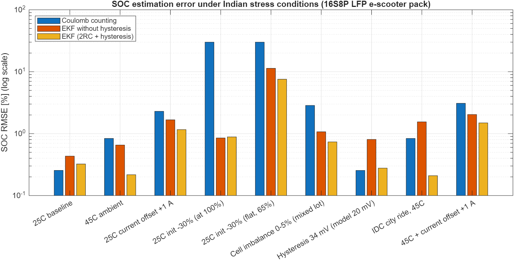
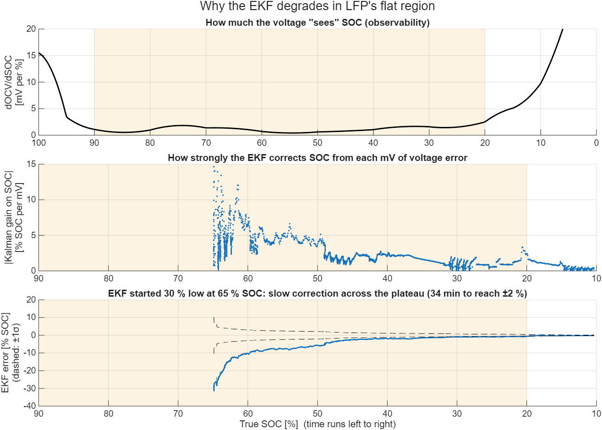
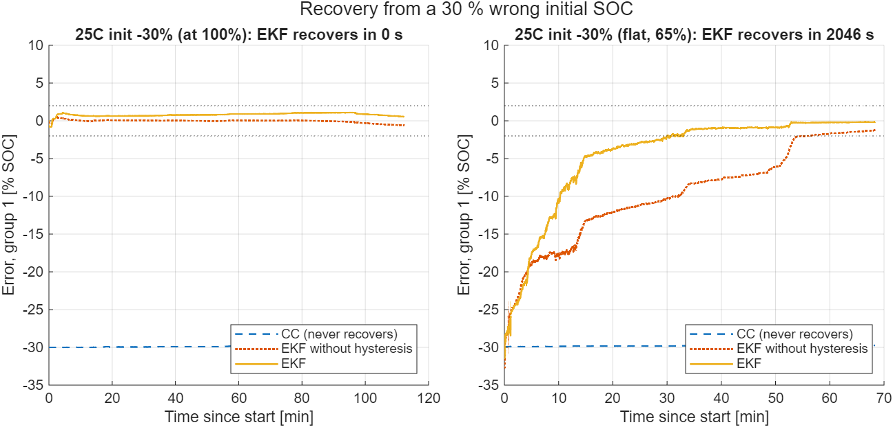
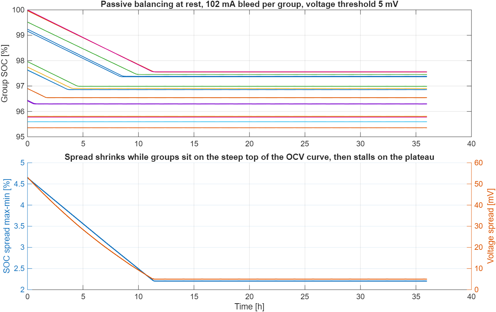

# SOC Estimation for an LFP E-Scooter Pack under Indian Conditions

How does an electric scooter know its battery percentage, and how wrong can that
number get in Indian heat and city traffic? This project builds the State-of-Charge
(SOC) logic of a BMS in MATLAB/Simulink and stress-tests it on a simulated
**16S8P LFP pack (51.2 V, 48 Ah, 2.46 kWh)** driven by Indian drive cycles.

**Main finding:** an Extended Kalman Filter (EKF) with a 2RC + hysteresis cell model
keeps SOC RMSE at or below **1.5 %** under 45 °C heat, a +1 A current-sensor offset and
0–5 % cell imbalance, where coulomb counting reaches **up to 3.1 % (max 6.1 %)**. But on
LFP's flat voltage plateau the EKF is nearly blind: a 30 % wrong starting SOC is fixed
in **under 1 s at full charge but takes 34 min (2046 s) at 65 % SOC**.



## What is modelled
| Block | Description |
|---|---|
| Cell | 6 Ah 32700 LFP, 2RC equivalent circuit, SOC- and temperature-dependent tables, one-state hysteresis (20 mV gap) — parameters checked against datasheets and literature |
| Pack (plant) | Simscape Battery 16S8P, 16 lumped group models, lumped thermal mass + air cooling, group-to-group heat conduction, cell variation (σ 0.5 % capacity, 1.5 % resistance), passive balancing (100 mA/group) |
| Load | Indian drive cycles **IDC** (2W certification) and **MIDC** (90 km/h stress cycle) → 190 kg scooter + rider → battery power → current (I = P/V) |
| BMS sensors | Pack current (σ 0.2 A, optional offset), 16 group voltages (σ 2 mV, 1 mV LSB), 4 NTCs |
| Estimators | Coulomb counting · EKF without hysteresis · EKF with 2RC + hysteresis (one per series group; displayed SOC = weakest group) |

## Results

### SOC accuracy (all 16 groups pooled; RMSE / max error)
| Scenario | Coulomb counting | EKF without hysteresis | **EKF (2RC + H)** | EKF recovery |
|---|---|---|---|---|
| 25 °C baseline (MIDC) | 0.25 / 0.82 % | 0.43 / 1.22 % | **0.32 / 0.97 %** | – |
| 45 °C ambient (MIDC) | 0.84 / 2.16 % | 0.65 / 1.58 % | **0.22 / 0.61 %** | – |
| IDC city ride, 45 °C | 0.84 / 2.16 % | 1.55 / 2.95 % | **0.21 / 0.61 %** | – |
| Current offset +1 A, 25 °C | 2.29 / 4.71 % | 1.67 / 3.48 % | **1.16 / 2.65 %** | – |
| 45 °C + offset +1 A | 3.09 / 6.11 % | 2.03 / 3.94 % | **1.49 / 3.06 %** | – |
| Wrong start −30 % at 100 % SOC | 30.0 / 30.8 % | 0.85 / 2.74 % | **0.88 / 2.08 %** | < 1 s |
| Wrong start −30 % at 65 % SOC (plateau) | 30.0 / 30.8 % | 11.3 / 39.0 % | **7.55 / 34.5 %** | **2046 s** |
| Cell imbalance 0–5 % (mixed lot) | 2.85 / 4.66 % | 1.07 / 2.86 % | **0.73 / 2.23 %** | 4 s |
| Hysteresis 34 mV in cells, 20 mV in model | 0.25 / 0.81 % | 0.81 / 1.92 % | **0.28 / 0.92 %** | – |

Full table: [results/tables/final_comparison.csv](results/tables/final_comparison.csv)

### Why the EKF degrades in LFP's flat region
Between ~20 % and 90 % SOC the open-circuit voltage changes by only **0.4–2.5 mV per % SOC**,
so the Kalman gain on SOC collapses and voltage errors are hardly corrected — the EKF
behaves almost like coulomb counting until SOC leaves the plateau.



### Pack, thermal and balancing
| | 25 °C MIDC | 45 °C MIDC | 45 °C IDC |
|---|---|---|---|
| Range to 10 % SOC | 57.5 km | 59.1 km | 109.8 km |
| Max cell temperature | 36.2 °C (+11.2 K) | 53.2 °C (+8.2 K) | 46.0 °C (+1.0 K) |
| Max group temperature spread | 1.6 K | 1.3 K | 0.2 K |

- **Validation:** on IDC the model gives 48.6 km/kWh vs the Ather Rizta LFP (2.7 kWh, 123 km
  IDC) 45.6 km/kWh — within +7 %.
- **Passive balancing** (100 mA/group, 5 mV threshold) reduced a 4.6 % SOC spread to
  **2.2 % in 11 h, then stalled**: once the high groups bleed down onto the plateau their
  voltage difference falls below the threshold. Ideal time for the full 4.6 % would be 21.8 h.
- **Imbalance:** with coulomb counting the displayed SOC still showed ~14.5 % when the
  weakest group hit the 10 % cut-off; the EKF tracked each group within ~1 %.



## Repository layout
```
src/+lfp/          cell model: parameters, OCV/hysteresis, 2RC step, Jacobians, simulate
src/+profiles/     pulse discharge, IDC, MIDC drive cycles
src/+vehicle/      e-scooter parameters, speed -> battery power
src/+battpack/     pack config, Simscape parameter mapping, variation, plant runner
src/+sensors/      BMS sensor model (noise, offset, quantisation, NTC placement)
src/+estimators/   coulomb counting, EKF (with a hook for a learned correction), pack runner
src/+metrics/      RMSE / MAE / max / recovery time / error by SOC band
models/            Simulink cell block, Simscape pack plant (generated by scripts)
scripts/           one script per step (week1_..., week2_..., week3_..., week4_...)
results/           figures and tables
docs/              literature review and parameter validation
```

## How to run (MATLAB R2025a, Simscape Battery, Powertrain Blockset)
```matlab
setup_paths
week1_cell_pulse_test          % cell model at 25 / 45 °C
week1_simulink_cell_check      % Simulink cell block == MATLAB reference (0 V error)
week2_midc_load_profile        % MIDC/IDC -> scooter power -> current, range + IDC validation
build_pack_model               % generates the Simscape Battery pack + plant model
week2_pack_midc                % pack on MIDC at 25 / 45 °C (~7 min)
week3_estimators               % CC vs EKF: baseline, 45 °C, offset, wrong initial SOC
week4_stress_balancing         % imbalance, hysteresis error, IDC 45 °C, balancing, final table (~20 min first run)
```

## Assumptions and limitations
- Cell parameters are datasheet/literature-representative, not fitted to one cell
  (see [docs/literature_review.md](docs/literature_review.md)).
- The plant is a simulation (Simscape), not a physical pack; parallel cells inside a
  group are lumped.
- IDC tail (85–108 s) and EUDC-low-power breakpoints are reconstructed; checked against
  published distance/speed/acceleration figures.
- Balancing is simulated at rest near full charge, not during a CC-CV charge.

## Roadmap
- [x] Week 1 – LFP cell model (2RC + hysteresis), pulse test, Simulink cell block
- [x] Week 2 – IDC/MIDC + vehicle model, Simscape 16S8P pack with thermal model and variation
- [x] Week 3 – Coulomb counting + EKF, metrics, flat-region (observability) analysis
- [x] Week 4 – Stress tests, passive balancing, final comparison
- [ ] Capstone – observability-aware EKF (adapt noise/gain on the plateau, bias state
      for the current offset, small learned correction via `opts.correction` in
      `estimators.ekf`)
